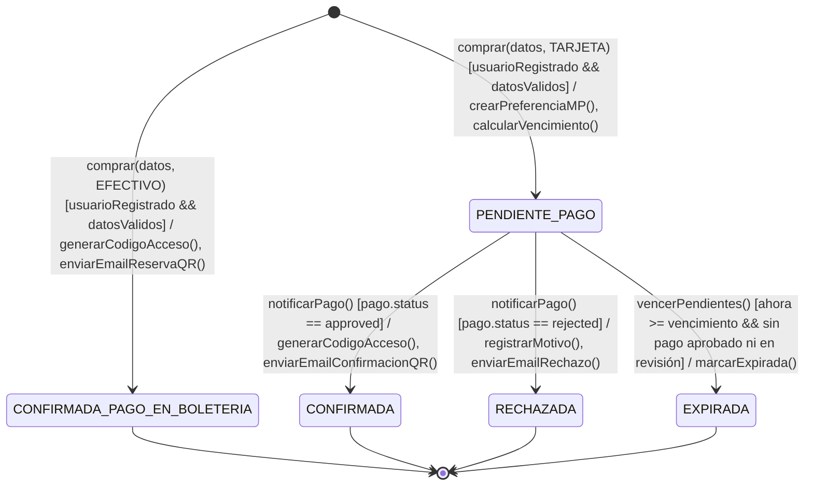
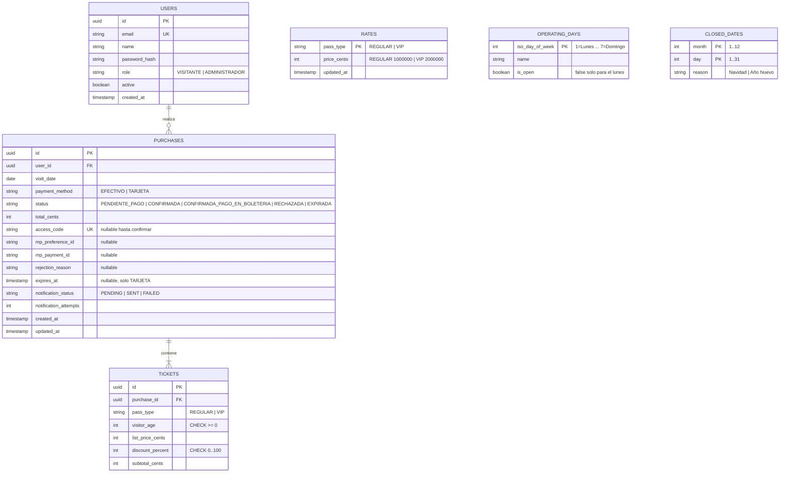
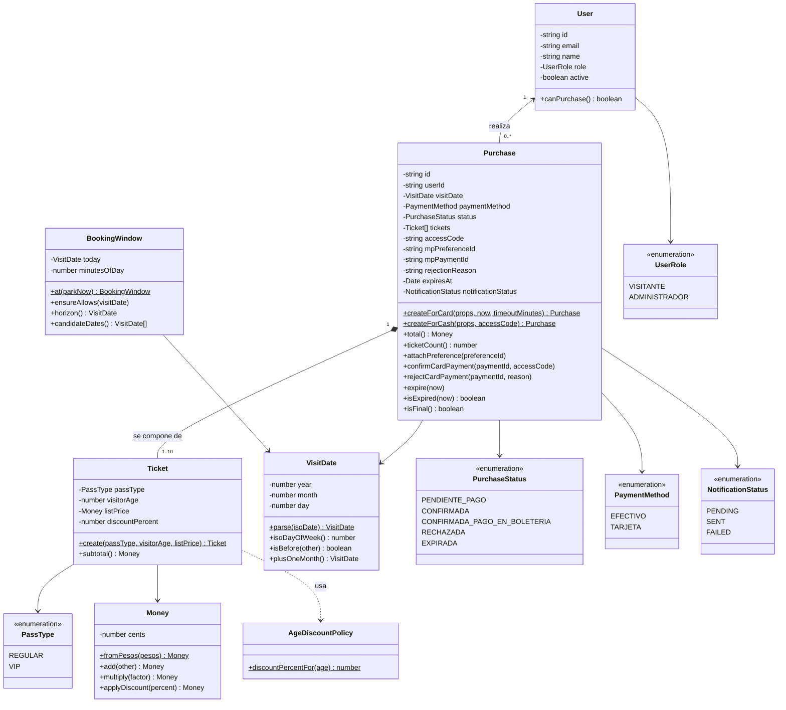
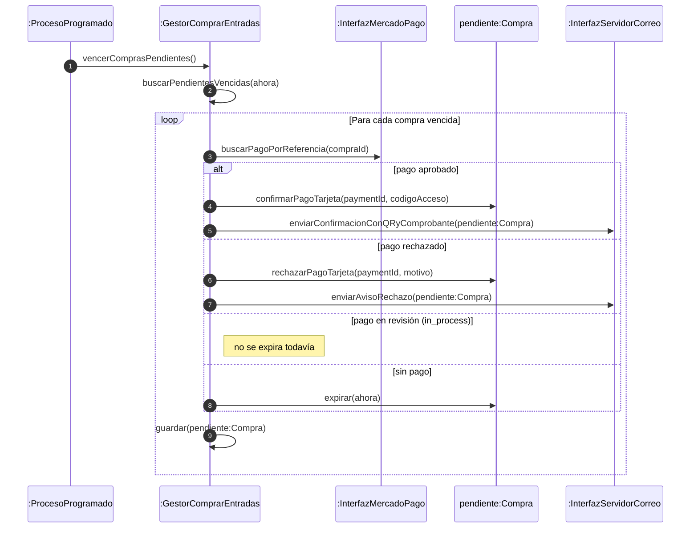

# Diseño Técnico y Arquitectura de Software
**User Story:** Comprar Entradas (EcoHarmony Park)  
**Patrón Arquitectónico:** Arquitectura Hexagonal (Ports & Adapters) con mapeo Boundary-Control-Entity  
**Estilo de Desarrollo:** Test-Driven Development (TDD)  
**Justificación de cada decisión:** `DECISIONES_DE_DISENO.md` (las referencias `ADR-XX` apuntan a ese documento).

---

## 1. Stack Tecnológico Seleccionado y Justificación

### 1.1. Matriz de Tecnologías y Librerías Principales

Versiones verificadas en el registro de npm y Docker Hub el 13/10/2026. Política: última versión estable **compatible** con el resto del stack (ADR-02).

| Componente / Responsabilidad | Tecnología / Librería | Versión | Justificación de Ingeniería y Selección |
| :--- | :--- | :--- | :--- |
| **Entorno de ejecución** | **Node.js** | 24 LTS | Requerido por NestJS 12 (`>= 20`) y TypeORM 1.x. |
| **Backend Framework** | **NestJS (`@nestjs/core`, `@nestjs/common`, `@nestjs/platform-express`)** | 12.1.x | Inyección de Dependencias nativa para implementar Puertos y Adaptadores, arquitectura modular y ciclo de vida predecible. Corre sobre Express. |
| **Lenguaje de Programación** | **TypeScript** | 6.0.3 | Tipado estático para contratos e interfaces de puertos. Fijado en 6.0.x porque `ts-jest` exige `<7` y `typescript-eslint` exige `<6.1` (ADR-02). |
| **Configuración** | **`@nestjs/config`** | 12.0.x | Carga y validación de variables de entorno. |
| **Motor de Base de Datos** | **PostgreSQL** (`postgres:18-alpine`) | 18.x | RDBMS con transacciones ACID, tipo UUID nativo y constraints (`FOREIGN KEY`, `CHECK`, `UNIQUE`). |
| **Mapeador Relacional (ORM)** | **TypeORM (`typeorm`, `@nestjs/typeorm`, `pg`)** | 1.1.x / 12.0.x / 8.x | Patrón **Data Mapper / Repository**: aísla las entidades de dominio de las tablas. Esquema gestionado con **migraciones** (`synchronize: false`). |
| **SDK Pasarela de Pago** | **`mercadopago`** | 3.6.x | SDK oficial de Mercado Pago para Node.js. Crea preferencias de Checkout Pro y consulta pagos. La API exacta del SDK se verifica contra su documentación al implementar el adaptador. |
| **Generador de Códigos QR** | **`qrcode`** | 1.5.x | Genera el QR en memoria como `Buffer` PNG, adjuntado inline al correo con CID (ADR-07). |
| **Comprobante PDF** | **`pdfkit`** | 0.20.x | Genera en memoria el comprobante que viaja adjunto en el correo (ADR-24). |
| **Envío de Correo** | **`nodemailer`** + **Mailpit** (`axllent/mailpit:v1.31.5`) | 10.x / 1.31.5 | Nodemailer envía por SMTP; Mailpit captura los correos localmente (SMTP `1025`, web `8025`) sin costo ni internet (ADR-15). Para la demostración con correo real, el mismo adaptador apunta al SMTP de **Resend** (plan gratuito), sin dependencias nuevas (ADR-27). |
| **Validación de Payloads** | **`class-validator` / `class-transformer`** | 0.15.x / 0.5.x | Validación de DTOs con el `ValidationPipe` de NestJS (`@IsDateString()`, `@IsEnum()`, `@IsInt()`, `@IsArray()`, `@ValidateNested()`, `@Type()`). Solo validan **forma**; los rangos (1 a 10 entradas, edad $\ge 0$) se validan en el dominio (`specs/spec.md` §1.2). |
| **Sesión** | **`MockSessionGuard`** (propio, sin librerías) | — | Sesión simulada de un visitante fijo, según el FAQ 19 (ADR-19). |
| **Tareas Programadas** | **`@nestjs/schedule`** | 12.0.x | Expiración de compras pendientes y reintento de correos (ADR-04, ADR-09). |
| **Suite de Testing (TDD)** | **Jest, `ts-jest`, `supertest`, `nock`** | 30.x / 29.4.x / 7.x / 15.x | Tests unitarios en memoria, de integración (HTTP de Mercado Pago grabado con `nock`) y E2E con simulación HTTP (ADR-16). Jest se ejecuta con `--experimental-vm-modules` porque NestJS 12 y `nock` 15 son solo ESM (ADR-02). |
| **Frontend Framework** | **React + Vite + TypeScript** | 19.x / 8.x / 6.0.x | SPA liviana con recarga en caliente (HMR). |
| **Diseño y Estilos UI** | **Tailwind CSS (`tailwindcss`, `@tailwindcss/vite`)** | 4.x | Utilidades CSS integradas como plugin de Vite (Tailwind 4 no usa `tailwind.config.js` por defecto). La paleta del PO se define como tokens con `@theme` (ADR-26). |
| **Tipografía** | **`@fontsource/lato`** | 5.x | Lato autoalojada, sin depender de un CDN (FAQ 3, ADR-26). |
| **Calendario** | **`react-day-picker`** | 10.x | Calendario accesible que permite deshabilitar fechas arbitrarias (FAQ 2, ADR-26). |
| **Cliente HTTP Frontend** | **Fetch API nativa** | — | Suficiente para los pocos endpoints del contrato; evita una dependencia adicional. |
| **Túnel de Desarrollo** | **`cloudflared`** | Última | Expone el backend local con una URL HTTPS pública para webhooks y `back_urls` de Mercado Pago (ADR-06). |
| **Orquestación de Entorno** | **Docker & Docker Compose** | 29.x | Levanta PostgreSQL (con la base de tests) y Mailpit con `docker compose up -d`. |

---

### 1.2. Estrategia del Frontend y Experiencia de Usuario (Demo en Vivo)
* **Web responsive *mobile-first*:** el PO pide una app mobile y acepta una web responsive (FAQ 24). Paleta del PO, tipografía Lato y logo propio validado por el PO (ADR-26).
* **Sesión simulada:** no hay pantalla de login (FAQ 19). El encabezado muestra el visitante que devuelve `GET /api/session`.
* **Pantalla de Compra de Entradas:** formulario que permite seleccionar la fecha en un calendario que **solo habilita las fechas disponibles** informadas por `GET /api/calendar/available-dates` (FAQ 2), y agregar de 1 a 10 entradas indicando edad y tipo de pase (`REGULAR` o `VIP`). Los subtotales con descuento por edad y el total se muestran a partir de `POST /api/purchases/quote`, sin duplicar reglas en el frontend.
* **Selector de Medio de Pago:** opciones `EFECTIVO` (pago en boletería) y `TARJETA` (Mercado Pago). Sin selección no se puede confirmar.
* **Manejo de Redirección y Retorno:**
  * **Tarjeta:** el frontend redirige al `init_point` de Checkout Pro. Al terminar, Mercado Pago redirige el navegador a `/api/payments/return` (backend, por el túnel), que reconcilia el pago y redirige a `/compras/:id/resultado` en el frontend, donde se consulta el estado de la compra.
  * **Efectivo:** se muestra directamente el resumen (identificador, fecha, cantidad, subtotales, total y estado) con la indicación de abonar en boletería; el QR y el comprobante llegan por correo.

---

### 1.3. Estrategia de Persistencia y Patrón Repositorio
* Se aplica el patrón **Data Mapper**: las entidades del dominio (`Purchase`, `Ticket`, `User`) son clases TypeScript puras, sin decoradores de TypeORM.
* La capa de infraestructura define entidades de persistencia (`PurchaseOrmEntity`, `TicketOrmEntity`, `UserOrmEntity`, `RateOrmEntity`, `OperatingDayOrmEntity`, `ClosedDateOrmEntity`) y *mappers* bidireccionales.
* El adaptador `TypeOrmPurchaseRepository` implementa `PurchaseRepositoryPort`; el núcleo de la aplicación nunca depende de TypeORM ni de SQL.
* **Límite por fecha (ADR-22):** `runExclusively(userId, visitDate, work)` abre una transacción y toma `pg_advisory_xact_lock` sobre la clave usuario + fecha; dentro se cuentan las entradas activas y se guarda la compra. El bloqueo se libera al terminar la transacción.
* El esquema se crea con **migraciones** versionadas y los datos iniciales (usuario de la sesión simulada, tarifas, días de apertura y feriados) con **seeds**.

---

### 1.4. Estrategia de Integración con Mercado Pago (Checkout Pro & Sandbox)
* **Credenciales de Prueba:** se usan las credenciales de prueba de la aplicación (*Tus integraciones > Credenciales de prueba*) y **cuentas de prueba** de vendedor y comprador (*Tus integraciones > Cuentas de prueba*). Para pagar se inicia sesión con el comprador de prueba en una ventana de incógnito.
* **Tarjetas de Prueba Oficiales (Argentina):**

| Tarjeta | Número | CVV | Vencimiento |
| :--- | :--- | :--- | :--- |
| Mastercard crédito | `5031 7557 3453 0604` | `123` | `11/30` |
| Visa crédito | `4509 9535 6623 3704` | `123` | `11/30` |
| American Express | `3711 803032 57522` | `1234` | `11/30` |
| Mastercard débito | `5287 3383 1025 3304` | `123` | `11/30` |
| Visa débito | `4002 7686 9439 5619` | `123` | `11/30` |

  El resultado del pago se simula con el **nombre del titular**: `APRO` (aprobado, DNI `12345678`), `OTHE` (rechazado por error general), `CONT` (pendiente), `FUND` (fondos insuficientes), entre otros.
* **Preferencia:** incluye `external_reference = purchaseId`, `notification_url`, `back_urls`, vencimiento (`expires`, `expiration_date_to`) y exclusión de medios de pago que no son tarjeta (ADR-05).
* **Webhook y reconciliación:** el webhook trae solo el ID del pago; el backend valida la firma, consulta el pago y actualiza la compra. Además reconcilia al retornar el navegador y antes de expirar (ADR-05).
* **Aislamiento en TDD:** el caso de uso depende de `PaymentGatewayPort`. En los tests unitarios se usa `FakePaymentGateway` (respuestas configurables en memoria); en integración, `MercadoPagoAdapter` contra respuestas HTTP grabadas con `nock`; en la demo, `MercadoPagoAdapter` contra el sandbox real.

---

### 1.5. Estrategia de Códigos QR y Notificaciones
* **QR:** un único QR por compra con un código opaco (`accessCode`). `QRCode.toBuffer(accessCode)` genera un PNG en memoria que se adjunta inline con `cid: 'qr-code'` y se referencia en la plantilla con `` (ADR-07).
* **Adaptadores de `EmailSenderPort`:**
  1. `NodemailerEmailAdapter` (desarrollo, integración y demo): envía por SMTP a uno de dos destinos, elegido solo con las variables `SMTP_*`:
     * **Mailpit** (por defecto, y único destino de los tests de integración): los correos se ven en `http://localhost:8025`.
     * **Resend** (opcional, demostración con correo real, ADR-27): `smtp.resend.com:465` con TLS. Sin dominio propio, el remitente es `onboarding@resend.dev` y el destinatario debe ser el email de la cuenta de Resend, que se configura como email del visitante simulado (`MOCK_SESSION_USER_EMAIL`).
  2. `SpyEmailSender` (tests unitarios): registra los correos en memoria para verificarlos en los asserts.
* **Contenido (ADR-24):** número de orden, fecha de visita, medio de pago, estado, tabla de entradas (tipo de pase, edad, precio de lista, descuento y subtotal) y total.
* **Comprobante PDF:** `ReceiptGeneratorPort` genera `comprobante-<purchaseId>.pdf` con los mismos datos y el QR; se adjunta como archivo descargable. Adaptadores: `PdfKitReceiptGenerator` (real) y `FakeReceiptGenerator` (tests unitarios).
* **Plantillas:** reserva para boletería (con QR, comprobante e indicación de pago pendiente), confirmación de pago con tarjeta (con QR y comprobante) y aviso de pago rechazado (sin QR ni comprobante).
* **Fallas:** si el envío falla, la compra no se revierte; `notificationStatus = FAILED` y un proceso programado reintenta (ADR-09).

---

### 1.6. Configuración de Variables de Entorno (`.env`)

El sistema se parametriza con **un único** archivo `.env` en la raíz de `TPG6-TDD/` (plantilla versionada: `.env.example`; el `.env` real **nunca** se versiona). Lo consumen dos procesos:
* **Docker Compose**, que lee automáticamente el `.env` de su carpeta para los puertos y credenciales de PostgreSQL.
* **El backend**, que se ejecuta desde `backend/` y por eso configura `ConfigModule.forRoot({ envFilePath: '../.env' })`.

Un solo archivo evita que la base de datos y el backend usen credenciales distintas. Si existe un `backend/.env` previo, se mueve a la raíz.

```env
# Entorno
NODE_ENV=development
PORT=3000
PARK_TIMEZONE=America/Argentina/Cordoba

# URLs (PUBLIC_API_URL = URL del túnel cloudflared, ADR-06)
PUBLIC_API_URL=https://xxxx.trycloudflare.com
FRONTEND_URL=http://localhost:5173

# Base de Datos PostgreSQL
DB_HOST=localhost
DB_PORT=5440
DB_USER=isw_user
DB_PASSWORD=isw_password
DB_NAME=ecoharmony_db
DB_NAME_TEST=ecoharmony_test

# Mercado Pago (credenciales de prueba)
MP_ACCESS_TOKEN=<access-token-de-prueba>
MP_WEBHOOK_SECRET=<clave-secreta-de-webhooks>
PURCHASE_PAYMENT_TIMEOUT_MINUTES=15

# Correo — Mailpit (por defecto, ADR-15)
SMTP_HOST=localhost
SMTP_PORT=1025
SMTP_SECURE=false
SMTP_USER=
SMTP_PASS=
MAIL_FROM="EcoHarmony Park <no-reply@ecoharmony.local>"

# Correo — Resend (opcional, correo real para la demo, ADR-27): reemplaza el bloque anterior
# SMTP_HOST=smtp.resend.com
# SMTP_PORT=465
# SMTP_SECURE=true
# SMTP_USER=resend
# SMTP_PASS=<api-key-de-resend>
# MAIL_FROM="EcoHarmony Park <onboarding@resend.dev>"

# Sesión simulada (ADR-19): visitante semilla
MOCK_SESSION_USER_ID=00000000-0000-4000-8000-000000000001
# Con Resend sin dominio propio, usar el email de la cuenta de Resend (ADR-27)
MOCK_SESSION_USER_EMAIL=visitante@ecoharmony.local
```

---

## 2. Matriz de Patrones de Software y TDD Aplicados

### 2.1. Patrones de Arquitectura y Diseño
* **Arquitectura Hexagonal (Ports & Adapters):** aísla el dominio de la infraestructura (base de datos, pasarela de pagos, correo, reloj).
* **Máquina de Estados Finita:** modela las transiciones de la compra e impide transiciones ilegales (sección 3).
* **Patrón Repositorio y Data Mapper:** media entre el dominio y PostgreSQL.
* **Value Object:** `Money` (centavos enteros, ADR-13) y `VisitDate` (fecha de calendario, ADR-12).
* **Inyección de Dependencias:** NestJS inyecta los adaptadores concretos en los casos de uso mediante tokens de interfaz (DIP de SOLID).
* **Outbox simplificado y Reconciliación:** garantizan la entrega del correo y la consistencia con Mercado Pago (ADR-05, ADR-09).

### 2.2. Patrones de TDD (Kent Beck)
* **Test List:** lista de casos planificada antes de codificar (`specs/tasks.md`).
* **Starter Test & One Step Test:** inicio incremental con pruebas mínimas que exploran la firma de la API y reglas atómicas.
* **Fake It & Triangulación:** retornos constantes para pasar a verde rápido, seguidos de tests adicionales que fuerzan la implementación general.
* **Obvious Implementation:** lógica evidente aplicada directamente (por ejemplo, el rango 1-10).
* **Isolated Tests & Evident Data:** pruebas independientes con datos autoexplicativos y reloj fijo.

---

## 3. Diagrama de Transición de Estados (DTE)

El ciclo de vida de la entidad `Purchase` se modela con la siguiente máquina de estados finita (ADR-03). La compra **solo existe si superó todas las validaciones**; una solicitud inválida se rechaza sin persistir nada. En la tabla, `fechaEnVentana` agrupa las reglas de `BookingWindow`: fecha no pasada, dentro del horizonte de un mes y antes del corte de las 17:30 si es para hoy (ADR-23).



### Tabla de Transiciones de Estados

| Estado Origen | Evento / Disparador | Condición de Guarda | Acción Asociada | Estado Destino |
| :--- | :--- | :--- | :--- | :--- |
| `[*] (Inicial)` | `comprar(datos, TARJETA)` | `[usuarioRegistrado && fechaEnVentana && parqueAbierto && cantidadValida && edadesValidas && dentroDelLimitePorFecha]` | `aplicarDescuentos(), crearPreferenciaMP(), calcularVencimiento()` | `PENDIENTE_PAGO` |
| `[*] (Inicial)` | `comprar(datos, EFECTIVO)` | `[usuarioRegistrado && fechaEnVentana && parqueAbierto && cantidadValida && edadesValidas && dentroDelLimitePorFecha]` | `aplicarDescuentos(), generarCodigoAcceso(), enviarEmailReservaQR()` | `CONFIRMADA_PAGO_EN_BOLETERIA` |
| `PENDIENTE_PAGO` | `notificarPago()` (webhook o reconciliación) | `[pago.status == 'approved']` | `registrarPago(), generarCodigoAcceso(), enviarEmailConfirmacionQR()` | `CONFIRMADA` |
| `PENDIENTE_PAGO` | `notificarPago()` (webhook o reconciliación) | `[pago.status == 'rejected']` | `registrarMotivo(), enviarEmailRechazo()` | `RECHAZADA` |
| `PENDIENTE_PAGO` | `vencerPendientes()` (proceso programado) | `[ahora >= vencimiento && sin pago 'approved' ni 'in_process']` | `marcarExpirada()` | `EXPIRADA` |
| Estado final | `notificarPago()` repetido | — | Ignorar (idempotencia, RC-04) | Sin cambio |

---

## 4. Diagrama Entidad-Relación (DER)

Estructura física de datos en **PostgreSQL**. Los importes se guardan en centavos enteros (ADR-13).



**Notas de diseño:**
* `TICKETS.list_price_cents` es una **copia** del precio vigente al momento de la compra; por eso no hay clave foránea hacia `RATES` (un cambio de tarifa no altera compras pasadas, ADR-20). `discount_percent` y `subtotal_cents` registran el descuento por edad aplicado (ADR-21).
* `RATES`, `OPERATING_DAYS` y `CLOSED_DATES` son tablas de configuración cargadas con seeds; se consultan, no se relacionan. `CLOSED_DATES` guarda feriados recurrentes por mes y día (25/12 y 01/01).
* Índice sobre `PURCHASES (user_id, visit_date)` para contar las entradas activas del usuario por fecha (CA-11).
* Constraint `CHECK` sobre la cantidad de entradas no es posible a nivel de fila; la regla 1..10 por compra se garantiza en el dominio (CA-02) y el límite por fecha en el caso de uso con bloqueo consultivo (CA-11, ADR-22).

---

## 5. Diagrama de Clases del Dominio (DCL)

Modelo del dominio puro, sin dependencias de frameworks. Los nombres coinciden con el código (inglés, ADR-17); los valores de negocio se mantienen en español.



`AgeDiscountPolicy` vive en `src/domain/services/`: es una regla del dominio sin estado propio (ADR-21). `BookingWindow` es un value object que concentra las reglas temporales de la compra (ADR-23).

### 5.1. Puertos del Dominio

| Puerto | Operaciones | Adaptador real | Doble de prueba |
| :--- | :--- | :--- | :--- |
| `UserRepositoryPort` | `findById(id)` | `TypeOrmUserRepository` | `InMemoryUserRepository` |
| `PurchaseRepositoryPort` | `save(purchase)`, `findById(id)`, `countActiveTickets(userId, visitDate)`, `runExclusively(userId, visitDate, work)`, `findPendingExpiredAt(now)`, `findWithFailedNotification()` | `TypeOrmPurchaseRepository` | `InMemoryPurchaseRepository` |
| `RatesProviderPort` | `priceFor(passType)` | `TypeOrmRatesProvider` | `FixedRatesProvider` |
| `OperatingCalendarPort` | `isOpenOn(visitDate)` (día de la semana y feriados) | `TypeOrmOperatingCalendar` | `FixedOperatingCalendar` |
| `PaymentGatewayPort` | `createPreference(purchase)`, `getPayment(paymentId)`, `findPaymentByReference(purchaseId)` | `MercadoPagoAdapter` | `FakePaymentGateway` |
| `EmailSenderPort` | `send(message)` | `NodemailerEmailAdapter` | `SpyEmailSender` |
| `QrGeneratorPort` | `toPng(content)` | `QrCodeAdapter` | `FakeQrGenerator` |
| `ReceiptGeneratorPort` | `toPdf(purchase, qrPng)` | `PdfKitReceiptGenerator` | `FakeReceiptGenerator` |
| `AccessCodeGeneratorPort` | `generate()` | `CryptoAccessCodeGenerator` | `SequentialAccessCodeGenerator` |
| `ClockPort` | `now()` (instante), `parkNow()` (fecha y hora del parque) | `SystemClock` (zona `PARK_TIMEZONE`) | `FixedClock` |

### 5.2. Mapeo del Análisis BCE al Código

| Clase de análisis (BCE) | Rol | Clase de diseño |
| :--- | :--- | :--- |
| `PantallaComprarEntradas` | Boundary (UI) | `PurchaseTicketsPage` (React) |
| `GestorComprarEntradas` | Control | `PurchaseTicketsUseCase`, `QuotePurchaseUseCase`, `GetAvailableVisitDatesUseCase`, `ProcessPaymentNotificationUseCase`, `ExpirePendingPurchasesUseCase` |
| `Compra`, `Entrada`, `Usuario`, `Tarifa`, `DiaOperacion`, `Feriado` | Entity | `Purchase`, `Ticket`, `User`, `RatesProviderPort`, `OperatingCalendarPort` |
| `InterfazMercadoPago` | Boundary (externo) | `MercadoPagoAdapter` (implementa `PaymentGatewayPort`) |
| `InterfazServidorCorreo` | Boundary (externo) | `NodemailerEmailAdapter` (implementa `EmailSenderPort`) |

---

## 6. Diagramas de Secuencia (Patrón Boundary-Control-Entity)

### 6.1. Flujo A: Compra con Tarjeta y Confirmación Asíncrona (Webhook + Reconciliación)

```mermaid
sequenceDiagram
    autonumber
    actor Visitante
    participant Pantalla as :PantallaComprarEntradas
    participant Gestor as :GestorComprarEntradas
    participant Usuario as logueado:Usuario
    participant Calendario as :DiaOperacion
    participant Tarifa as actual:Tarifa
    participant Compra as nueva:Compra
    participant MP as :InterfazMercadoPago
    actor PasarelaMP as Pasarela Mercado Pago
    participant Mailer as :InterfazServidorCorreo

    Visitante->>Pantalla: opcComprarEntradas()
    Pantalla-->>Visitante: solicita fecha, entradas (tipo de pase y edad) y medio de pago
    Visitante->>Pantalla: confirmarCompra(fecha, entradas, TARJETA)
    Pantalla->>Gestor: comprarEntradas(sesion, fecha, entradas, TARJETA)

    Gestor->>Usuario: puedeComprar()
    Usuario-->>Gestor: true
    Gestor->>Gestor: validarVentana(fecha, ahoraParque)
    Note right of Gestor: no pasada, horizonte de un mes y corte de las 17:30 si es hoy
    Gestor->>Calendario: estaAbierto(fecha)
    Calendario-->>Gestor: true
    loop Para cada entrada (1 a 10)
        Gestor->>Tarifa: precioPara(tipoPase)
        Tarifa-->>Gestor: precioVigente
    end
    Gestor->>Compra: crearParaTarjeta(datos, ahora, plazo)
    Note right of Compra: valida cantidad y edades y aplica el descuento por edad; estado PENDIENTE_PAGO
    Note over Gestor,Compra: bajo bloqueo por usuario y fecha (ADR-22)
    Gestor->>Gestor: validarLimitePorFecha(entradasActivas + cantidad <= 10)
    Gestor->>MP: crearPreferencia(nueva:Compra)
    MP-->>Gestor: { preferenceId, initPoint }
    Gestor->>Compra: asociarPreferencia(preferenceId)
    Gestor->>Gestor: guardar(nueva:Compra)
    Gestor-->>Pantalla: resumen(compraId, fecha, cantidad, total, PENDIENTE_PAGO, initPoint)
    Pantalla-->>Visitante: redirigir a initPoint

    Note over Visitante,PasarelaMP: El visitante paga en Checkout Pro

    PasarelaMP->>MP: POST webhook { type: payment, data.id } + x-signature
    MP->>MP: validarFirma(x-signature)
    MP->>Gestor: procesarNotificacionPago(paymentId)
    Gestor->>MP: obtenerPago(paymentId)
    MP-->>Gestor: { status: approved, external_reference: compraId }
    Gestor->>Compra: confirmarPagoTarjeta(paymentId, codigoAcceso)
    Gestor->>Gestor: guardar(nueva:Compra)
    Gestor->>Mailer: enviarConfirmacionConQRyComprobante(nueva:Compra)
    Mailer-->>Gestor: ok
    MP-->>PasarelaMP: HTTP 200

    Note over Visitante,Pantalla: Mercado Pago redirige el navegador a /api/payments/return
    Visitante->>Gestor: retornarDesdePasarela(compraId, paymentId)
    Gestor->>MP: obtenerPago(paymentId)
    Note right of Gestor: reconciliación idempotente: si ya está CONFIRMADA no hace nada
    Gestor-->>Pantalla: redirigir a /compras/:id/resultado
    Pantalla->>Gestor: consultarCompra(compraId)
    Gestor-->>Pantalla: resumen(compraId, fecha, cantidad, CONFIRMADA)
    Pantalla-->>Visitante: muestra la compra confirmada
```

---

### 6.2. Flujo B: Compra con Efectivo en Boletería

```mermaid
sequenceDiagram
    autonumber
    actor Visitante
    participant Pantalla as :PantallaComprarEntradas
    participant Gestor as :GestorComprarEntradas
    participant Usuario as logueado:Usuario
    participant Calendario as :DiaOperacion
    participant Tarifa as actual:Tarifa
    participant Compra as nueva:Compra
    participant Mailer as :InterfazServidorCorreo

    Visitante->>Pantalla: opcComprarEntradas()
    Pantalla-->>Visitante: solicita fecha, entradas (tipo de pase y edad) y medio de pago
    Visitante->>Pantalla: confirmarCompra(fecha, entradas, EFECTIVO)
    Pantalla->>Gestor: comprarEntradas(sesion, fecha, entradas, EFECTIVO)

    Gestor->>Usuario: puedeComprar()
    Usuario-->>Gestor: true
    Gestor->>Gestor: validarVentana(fecha, ahoraParque)
    Note right of Gestor: no pasada, horizonte de un mes y corte de las 17:30 si es hoy
    Gestor->>Calendario: estaAbierto(fecha)
    Calendario-->>Gestor: true
    loop Para cada entrada (1 a 10)
        Gestor->>Tarifa: precioPara(tipoPase)
        Tarifa-->>Gestor: precioVigente
    end
    Gestor->>Compra: crearParaEfectivo(datos, codigoAcceso)
    Note right of Compra: valida cantidad y edades y aplica el descuento por edad; estado CONFIRMADA_PAGO_EN_BOLETERIA
    Note over Gestor,Compra: bajo bloqueo por usuario y fecha (ADR-22)
    Gestor->>Gestor: validarLimitePorFecha(entradasActivas + cantidad <= 10)
    Gestor->>Gestor: guardar(nueva:Compra)
    Gestor->>Mailer: enviarReservaConQRyComprobante(nueva:Compra)
    Mailer-->>Gestor: ok (si falla: notificationStatus = FAILED, sin revertir)

    Gestor-->>Pantalla: resumen(compraId, fecha, cantidad, total, CONFIRMADA_PAGO_EN_BOLETERIA)
    Pantalla-->>Visitante: muestra el resumen e instrucciones de pago en boletería
```

---

### 6.3. Flujo C: Expiración de Compras Pendientes



---

## 7. Estrategia de Pruebas y Pirámide de Testing

La estrategia de aseguramiento de calidad se estructura bajo la **Pirámide de Pruebas** (Mike Cohn, Martin Fowler) y TDD (Kent Beck). La ubicación de los tests y sus comandos se definen en ADR-16.

```
                      ▲
                     / \
                    /   \
                   / E2E \       --> Nivel 3: Pruebas End-to-End (API completa)
                  /-------\
                 / Integr. \     --> Nivel 2: Integración y Contratos de Adaptadores
                /-----------\
               /  Unitarias  \   --> Nivel 1: TDD Core (Dominio y Casos de Uso Aislados)
              /   TDD Core    \
             /─────────────────\
```

### 7.1. Nivel 1: Pruebas Unitarias de Dominio y Casos de Uso (TDD Core)
* **Objetivo:** cubrir todas las reglas de negocio, validaciones del dominio y transiciones de la máquina de estados.
* **Aislamiento técnico:** sin red, archivos ni base de datos. Los puertos se satisfacen con dobles de prueba en memoria y el tiempo con `FixedClock`.
* **Justificación:**
  * **Velocidad de feedback:** el ciclo Red-Green-Refactor exige ejecutar la suite tras cada cambio; en memoria tarda milisegundos.
  * **Determinismo:** sin *flakiness* por cortes de red, latencia o servicios caídos.
  * **Simulación de escenarios críticos:** fechas pasadas, días cerrados, pagos rechazados o vencidos y fallas de correo se fuerzan a demanda.

### 7.2. Nivel 2: Pruebas de Integración y Contratos de Adaptadores
* **Objetivo:** verificar que cada adaptador implementa fielmente su puerto.
* **Alcance técnico:**
  * **Persistencia:** contra PostgreSQL real en Docker (base `ecoharmony_test`), validando migraciones, constraints y mapeos.
  * **Pasarela de pagos:** `MercadoPagoAdapter` contra respuestas HTTP grabadas con `nock`, verificando el formato de la preferencia y la interpretación de pagos.
  * **Correo:** `NodemailerEmailAdapter` contra Mailpit, verificando destinatario, asunto, HTML, QR inline y comprobante PDF adjunto (consultando la API de Mailpit).
  * **Límite por fecha:** dos compras concurrentes del mismo usuario y fecha contra PostgreSQL real, para verificar el bloqueo consultivo (ADR-22).
  * **Firma del webhook:** validación de `x-signature` con firmas válidas e inválidas.

### 7.3. Nivel 3: Pruebas End-to-End (API)
* **Objetivo:** verificar los endpoints REST de punta a punta con `supertest` (códigos HTTP, validaciones de DTO, sesión simulada y contrato de errores), con la pasarela de pago reemplazada por su doble.
* **Demostración manual:** el flujo completo contra el sandbox real de Mercado Pago, el túnel y Mailpit se ejecuta como prueba de aceptación manual (PU-OF-01), no como test automatizado, para no depender de internet en la suite.

### 7.4. Matriz Comparativa de Niveles de Prueba

| Nivel | Foco Principal | Dependencia de Red / I/O | Tiempo Típico de Ejecución | Frecuencia de Ejecución |
| :--- | :--- | :--- | :--- | :--- |
| **Unitarias (TDD Core)** | Reglas de negocio, entidades, máquina de estados | Nula (memoria) | < 5 ms por test | Continua (cada guardado) |
| **Integración / Contratos** | Adaptadores PostgreSQL, Mercado Pago (`nock`), SMTP | Local (Docker) | 50 - 500 ms por test | Al cerrar cada adaptador |
| **E2E (API)** | Endpoints, sesión simulada, contrato de errores | Local | 100 ms - 1 s por test | Al cerrar cada endpoint |
| **Aceptación manual** | Flujo real con sandbox, túnel, Mailpit y, opcionalmente, Resend | Internet | Minutos | Antes de la demostración |
