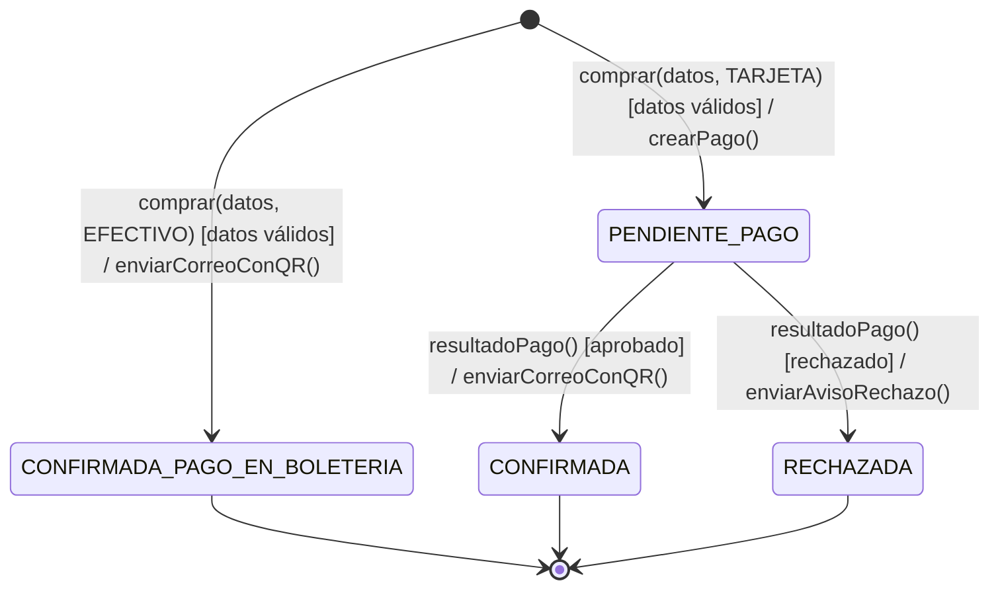
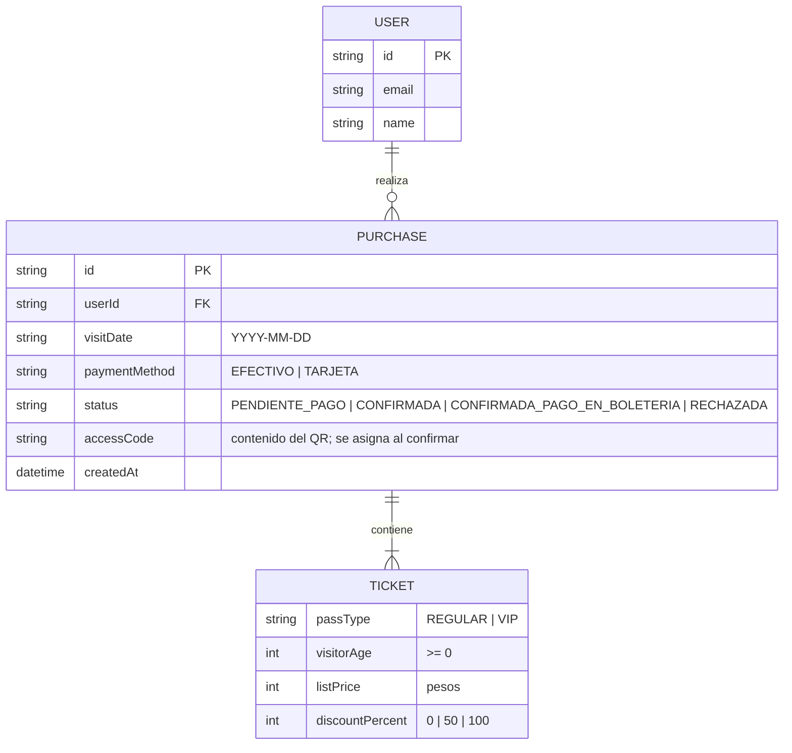
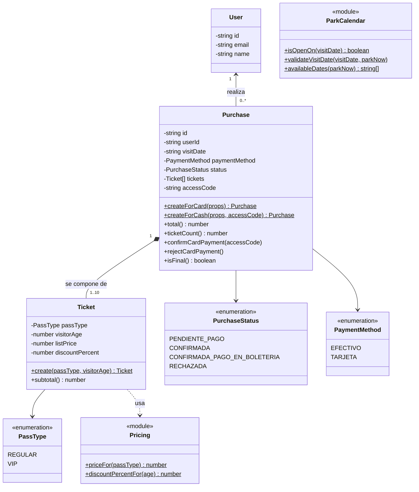
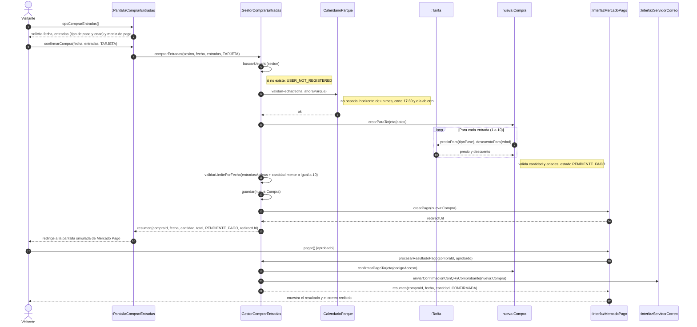
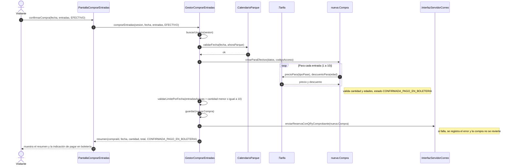

# Diseño y Decisiones de Diseño
**User Story:** Comprar Entradas (EcoHarmony Park)  
**Desarrollo:** Test-Driven Development (Red → Green → Refactor)  
**Requerimientos:** `ESPECIFICACION_USER_STORY.md` (referencias `CA-XX`, `RC-XX`, `PU-XX`). **Estilo de código:** `GUIA_DE_ESTILO.md`.

---

## 1. Visión General

Una web responsive (React) consume una API REST (Express). La lógica de negocio vive en el backend, separada de Express, para poder construirla y probarla con TDD sin levantar el servidor.

El PO permite simular el pago (FAQ 4), el correo (FAQ 5) y la sesión (FAQ 19), y no exige persistencia. Por eso todo lo externo es simulado: los datos viven en memoria, Mercado Pago es una pantalla propia y el correo se muestra en una bandeja dentro de la aplicación. El esfuerzo se concentra en las reglas de negocio.

**Capas y mapeo con BCE:**

| Capa | Responsabilidad | Rol BCE |
| :--- | :--- | :--- |
| `routes/` (y pantallas React) | Recibir el request, validar su forma y responder. | Boundary |
| `services/` | Ejecutar una acción del usuario: comprar, procesar el pago, cotizar. | Control |
| `domain/` | Reglas de negocio puras: precios, descuentos, calendario, límites, estados. | Entity |
| `infra/` | Datos en memoria, reloj, Mercado Pago simulado, bandeja de correo simulada. | Boundary externo |

Los servicios no crean lo externo: lo **reciben como parámetro** (inyección de dependencias). `createApp(deps)` arma la aplicación con lo que recibe; `server.ts` le pasa las implementaciones reales y los tests, las de prueba.

---

## 2. Stack

| Uso | Tecnología |
| :--- | :--- |
| Backend | Node.js 24 LTS, TypeScript, Express 5 |
| Validación de la forma del request | Zod |
| Ejecución en desarrollo | `tsx` (`tsx watch`) |
| QR y comprobante PDF del correo | `qrcode`, `pdfkit` |
| Tests | Vitest, `supertest` |
| Frontend | React + Vite + TypeScript, React Router |
| Estilos y UI | Tailwind CSS 4, `@fontsource/lato`, `react-day-picker` |

En desarrollo, el proxy de Vite reenvía `/api` al backend. Variables de entorno (`backend/.env`, leído con `node --env-file`):

```env
PORT=3000
PARK_TIMEZONE=America/Argentina/Cordoba
MOCK_SESSION_USER_ID=visitor-1
```

---

## 3. Estructura del Proyecto

```text
backend/
├── data/initial-data.json    # Usuarios iniciales; se cargan en memoria al arrancar
├── src/
│   ├── domain/
│   │   ├── types.ts          # Enums y tipos: PassType, PaymentMethod, PurchaseStatus, User
│   │   ├── pricing.ts        # Precios por pase y descuentos por edad
│   │   ├── park-calendar.ts  # Días de apertura y ventana de compra
│   │   ├── purchase.ts       # Purchase y Ticket
│   │   └── errors.ts         # DomainError y códigos
│   ├── services/             # purchase-tickets, process-payment-result, quote-purchase, get-available-dates, get-purchase
│   ├── infra/                # in-memory-repository, system-clock, simulated-payment-gateway, simulated-mailbox
│   ├── routes/               # Rutas, esquemas de Zod, sesión simulada y manejo de errores
│   ├── app.ts                # createApp(deps)
│   └── server.ts             # Crea las dependencias reales y levanta el servidor
└── test/
    ├── unit/                 # domain/ y services/
    ├── e2e/                  # Rutas con supertest
    ├── doubles/              # FixedClock, FakePaymentGateway, SpyEmailSender
    └── builders/             # Test Data Builders

frontend/src/
├── pages/                    # Compra, Checkout de Mercado Pago (simulado), Resultado
└── components/               # Calendario, formulario de entradas, modal de correo
```

---

## 4. Dependencias Externas

Solo se inyecta lo que el dominio no puede resolver por sí mismo. Las reglas fijas del FAQ son código del dominio, no dependencias.

| Interfaz | Operaciones | En la aplicación | En los tests |
| :--- | :--- | :--- | :--- |
| `Clock` | `parkNow()`: fecha y hora actuales en la zona del parque | `SystemClock` | `FixedClock` |
| `Repository` | `findUser(id)`, `savePurchase(p)`, `findPurchase(id)`, `countActiveTickets(userId, visitDate)` | `InMemoryRepository` | `InMemoryRepository` con datos de prueba |
| `PaymentGateway` | `createPayment(purchase)` → `{ redirectUrl }` | `SimulatedPaymentGateway` | `FakePaymentGateway` |
| `EmailSender` | `send(email)` | `SimulatedMailbox`: genera QR y PDF y guarda el correo | `SpyEmailSender` |

---

## 5. Endpoints

| Endpoint | Servicio | Qué hace |
| :--- | :--- | :--- |
| `GET /api/session` | — | Visitante de la sesión simulada. |
| `GET /api/calendar/available-dates` | `getAvailableDates` | Fechas comprables, para que el calendario deshabilite el resto (FAQ 2). |
| `POST /api/purchases/quote` | `quotePurchase` | Subtotales con descuento y total, sin crear la compra. |
| `POST /api/purchases` | `purchaseTickets` | Valida y crea la compra; con tarjeta devuelve la URL de Mercado Pago, con efectivo envía el correo. |
| `POST /api/purchases/:id/payment-result` | `processPaymentResult` | Lo llama la pantalla simulada de Mercado Pago al aprobar o rechazar. |
| `GET /api/purchases/:id` | `getPurchase` | Resumen final: fecha, cantidad, total y estado (CA-10). |
| `GET /api/purchases/:id/emails` | — | Correos de la bandeja simulada, con QR y PDF. |

---

## 6. Diagramas

### 6.1. Estados de la Compra

La compra solo existe si superó todas las validaciones; una solicitud inválida se rechaza sin guardar nada.



`[datos válidos]` agrupa: usuario registrado, fecha en la ventana de compra, parque abierto, entre 1 y 10 entradas, edades válidas y límite de 10 entradas por fecha. Un resultado de pago sobre una compra en estado final se rechaza (RC-03).

### 6.2. Modelo de Datos



### 6.3. Diagrama de Clases del Dominio



`Pricing` y `ParkCalendar` son módulos de funciones sin estado: concentran las reglas fijas del FAQ (precios, descuentos, días de apertura, horizonte de un mes y corte de las 17:30).

### 6.4. Secuencia: Compra con Tarjeta



### 6.5. Secuencia: Compra en Efectivo



---

## 7. Pruebas

| Nivel | Qué verifica | Ubicación |
| :--- | :--- | :--- |
| **Unitario** (núcleo del TDD) | Reglas del dominio y servicios: precios, descuentos, fechas, límites, estados, redirección a Mercado Pago y envío del correo. Sin red ni reloj real. | `backend/test/unit/` |
| **End-to-end** | Rutas con `supertest`: códigos HTTP, validación del request, sesión simulada y errores. | `backend/test/e2e/` |

* Toda regla nace de un test en rojo y se commitea por fase (`test:`, `feat:`, `refactor:`), según `GUIA_DE_ESTILO.md`.
* Valores límite obligatorios: edades 0, 3, 4, 15, 16, 59 y 60; cantidades 0, 1, 10 y 11; horas 17:30 y 17:31; fin de mes para el horizonte.
* El QR y el PDF se verifican manualmente en la demostración, junto con el recorrido completo de PU-OF-01.

---

## 8. Decisiones de Diseño

**D-01 — Capas con inyección de dependencias, no una arquitectura más elaborada.** El sistema es una sola User Story que no irá a producción. Lo único que TDD exige es que la lógica de negocio esté fuera de Express y que lo externo (reloj, datos, pago y correo) se reciba como parámetro para reemplazarlo en los tests. Se descartó una arquitectura hexagonal completa (puertos y adaptadores para cada dependencia, capas y carpetas separadas por tipo de objeto): su beneficio principal, cambiar la infraestructura sin tocar el negocio, no aplica a este alcance. También se descartó la lógica dentro de las rutas, porque obliga a probar cada regla a través de HTTP.

**D-02 — Express en lugar de NestJS.** Para cuatro o cinco endpoints, los módulos, decoradores y el contenedor de inyección de NestJS agregan estructura sin beneficio; `createApp(deps)` cumple el mismo rol.

**D-03 — Datos en memoria.** El PO no exige persistencia. Al arrancar, los usuarios se cargan desde `initial-data.json`; las compras se guardan en memoria, nunca se escriben al archivo y se pierden al reiniciar. El mismo repositorio en memoria se usa en los tests, con datos propios en cada uno.

**D-04 — Mercado Pago simulado (FAQ 4).** Una pantalla propia con estética de Mercado Pago muestra el detalle y el total de la transacción y permite aprobar o rechazar el pago. La integración real exigiría credenciales de prueba, webhooks y un túnel público, con riesgo de falla en la demostración.

**D-05 — Correo simulado (FAQ 5).** El correo se guarda en una bandeja en memoria y el frontend lo muestra en un modal con estética de cliente de correo. Contiene número de orden, fecha, medio de pago, estado, detalle de cada entrada con su subtotal, total y QR, más un comprobante PDF adjunto. El aviso de rechazo no lleva QR ni PDF. Si el envío falla, la compra no se revierte (RC-04).

**D-06 — Un QR por compra con un código opaco.** Los docentes pidieron QR para ambos medios de pago. El QR contiene solo un código de acceso aleatorio (`randomUUID()`), nunca datos personales ni importes. Se asigna al confirmar la compra.

**D-07 — Cuatro estados.** `PENDIENTE_PAGO`, `CONFIRMADA`, `CONFIRMADA_PAGO_EN_BOLETERIA` y `RECHAZADA`. No hay `INICIADA` (el formulario se envía en un único request), ni `CANCELADA` (fuera del alcance), ni `EXPIRADA` (con el pago simulado, el resultado llega en el momento).

**D-08 — Sesión simulada (FAQ 19).** Sin login. Un middleware toma el usuario de `MOCK_SESSION_USER_ID`; el identificador nunca viaja en el cuerpo del request. El servicio verifica que exista y, si no, rechaza con `USER_NOT_REGISTERED` (CA-01).

**D-09 — Reglas del FAQ como código del dominio.** Precios, descuentos, días de apertura, feriados, horizonte y corte horario son constantes y funciones en `pricing.ts` y `park-calendar.ts`, no datos configurables: cambiarlas es cambiar una regla de negocio y debe pasar por sus tests. Los importes se manejan en **pesos enteros**: con precios de $10.000 y $20.000 y descuentos de 0, 50 y 100%, nunca hay decimales.

**D-10 — Fechas y reloj.** `new Date("2026-10-13")` se interpreta como medianoche UTC, que en Córdoba es el día anterior: un martes podría evaluarse como lunes. Por eso la fecha de visita es un texto `YYYY-MM-DD` que se interpreta como fecha de calendario, y la fecha y hora actuales se obtienen de `Clock` en la zona del parque. Los tests usan `FixedClock`. "Un mes" es la misma fecha del mes siguiente o, si no existe, el último día de ese mes.

**D-11 — Límite de 10 entradas por fecha (FAQ 27).** Se suman las entradas del usuario para esa fecha en compras `PENDIENTE_PAGO`, `CONFIRMADA` y `CONFIRMADA_PAGO_EN_BOLETERIA`. Las rechazadas no cuentan.

**D-12 — Contrato de errores.** La forma del request se valida con Zod y responde `400 VALIDATION_ERROR` con todos los errores (cubre PU-OF-02, sin medio de pago). Las reglas de negocio lanzan un `DomainError` con un código estable y se detienen en la primera violada, en este orden: usuario → fecha no pasada → horizonte → corte → día abierto → cantidad → edades → límite por fecha.

| Código | HTTP | Regla |
| :--- | :--- | :--- |
| `VALIDATION_ERROR` | 400 | Forma del request |
| `USER_NOT_REGISTERED` | 403 | CA-01 |
| `VISIT_DATE_IN_PAST` | 422 | CA-03 |
| `VISIT_DATE_BEYOND_HORIZON` | 422 | CA-13 |
| `SAME_DAY_CUTOFF_EXCEEDED` | 422 | CA-14 |
| `PARK_CLOSED` | 422 | CA-04 |
| `INVALID_TICKET_QUANTITY` | 422 | CA-02 |
| `INVALID_VISITOR_AGE` | 422 | CA-05 |
| `TICKET_LIMIT_PER_DATE_EXCEEDED` | 422 | CA-11 |
| `PURCHASE_NOT_FOUND` | 404 | Compra inexistente |
| `PURCHASE_ALREADY_FINALIZED` | 409 | RC-03 |

**D-13 — Interfaz (FAQ 2, 3, 17 y 24).** Web responsive *mobile-first*, paleta del PO como tokens de Tailwind, tipografía Lato y logo propio validado por el PO. El calendario solo habilita las fechas que devuelve el backend, y los totales se piden a `/quote`, para no duplicar reglas en el frontend.

**D-14 — Commits por fase de TDD.** Un commit `test:` (rojo), uno `feat:` (verde) y, si hubo mejora, uno `refactor:` por cada ítem de la lista de tests. El historial de Git queda como evidencia de que cada test se escribió antes que su código. El resto del repositorio mantiene la convención del Plan de Gestión de Configuración (TPG4).
