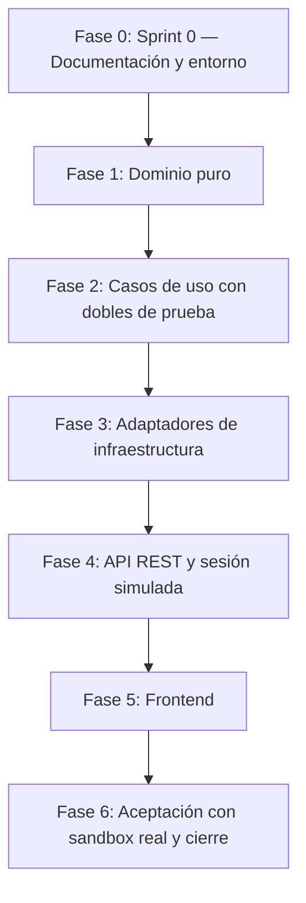

# Plan de Implementación — Comprar Entradas
> **Cátedra:** Ingeniería y Calidad de Software (UTN - FRC) — Curso 4K1 — Grupo 11  
> **Metodología:** Spec-Driven Development (SDD) + Test-Driven Development (TDD) estricto  
> **Insumos:** `specs/spec.md` (contrato y escenarios), `specs/tasks.md` (Test List y trazabilidad), `Documentación/` (especificación, diseño, decisiones y guía de estilo).

---

## 1. Objetivos

1. **TDD estricto:** cada comportamiento nace de un test en rojo (*Red*), se implementa con el código mínimo (*Green*) y se mejora sin cambiar comportamiento (*Refactor*). Ninguna línea de código de producción sin un test que la exija.
2. **Desacoplamiento:** dominio y aplicación sin dependencias de frameworks, ORM ni servicios externos (ADR-01).
3. **Costo cero:** PostgreSQL y Mailpit en Docker, sandbox de Mercado Pago, túnel gratuito y plan gratuito de Resend (opcional, ADR-27).
4. **Trazabilidad completa:** cada CA, RC y PU de `ESPECIFICACION_USER_STORY.md` y cada escenario E-* de `spec.md` cubierto por al menos un test (matriz en `tasks.md`).

---

## 2. Estrategia: de adentro hacia afuera

El desarrollo avanza **del dominio hacia la infraestructura** (*inside-out*): primero las reglas de negocio puras, luego la orquestación con dobles de prueba, y recién al final las tecnologías concretas. Así el diseño del dominio lo dictan los tests y no la base de datos ni el framework.

---

## 3. Fases

### Fase 0: Sprint 0 — Documentación y Entorno
* **Entregables:** documentación alineada con el TP6 y con el FAQ del PO (ADR-18), `DECISIONES_DE_DISENO.md`, `GUIA_DE_ESTILO.md`, `specs/` reescrito, `AGENTS.md`, `.gitignore`, dependencias actualizadas, Jest configurado por niveles, `docker-compose.yml` con base de tests.
* **Spike de Mercado Pago (previo a la Fase 3):** con la cuenta del equipo, crear la aplicación y las cuentas de prueba, levantar el túnel y verificar con un script descartable: (a) creación de preferencia, (b) pago con tarjeta de prueba `APRO`, (c) recepción del webhook real con la URL de *Modo pruebas* registrada en el panel, validando la firma con `WebhookSignatureValidator`, (d) **pregunta abierta:** si la notificación originada por la `notification_url` de la preferencia también trae `x-signature` válida (define la variante del ADR-05), (e) parámetros que agrega Mercado Pago en `back_urls`. El resultado se registra en `DECISIONES_DE_DISENO.md` (ADR-05). El código del spike no se conserva.
* **Gate:** `npm test`, `npm run lint` y `npm run build` del backend y `npm run build` del frontend en verde con la configuración nueva.

### Fase 1: Dominio Puro
* **Objetivo:** modelar las reglas de negocio sin dependencias externas.
* **Elementos:** `Money` (con `applyDiscount`), `AgeDiscountPolicy`, `VisitDate`, `BookingWindow` (fecha no pasada, horizonte de un mes y corte de las 17:30), enums (`PassType`, `PaymentMethod`, `PurchaseStatus`, `UserRole`, `NotificationStatus`), errores de dominio, `Ticket` (precio de lista, descuento y subtotal), `Purchase` (invariantes y máquina de estados), `User.canPurchase()`.
* **Tests:** `test/unit/domain/**` (ítems `T-DOM-*` de `tasks.md`).
* **Gate:** todos los `T-DOM-*` en verde; suite unitaria en menos de 1 segundo; cero imports de NestJS o TypeORM en `src/domain/`.

### Fase 2: Casos de Uso con Dobles de Prueba
* **Objetivo:** orquestar el flujo de compra (el Gestor del análisis BCE) contra puertos.
* **Elementos:** puertos de `src/domain/ports/` (tabla 5.1 del diseño); dobles en `test/doubles/`; `PurchaseTicketsUseCase` (incluye el límite de 10 entradas por fecha), `QuotePurchaseUseCase`, `GetAvailableVisitDatesUseCase`, `GetSessionUserUseCase`, `ProcessPaymentNotificationUseCase`, `ExpirePendingPurchasesUseCase`, `RetryFailedNotificationsUseCase`, `GetPurchaseUseCase`.
* **Tests:** `test/unit/application/**` (ítems `T-APP-*`).
* **Gate:** todos los `T-APP-*` en verde sin base de datos ni red.

### Fase 3: Adaptadores de Infraestructura
* **Objetivo:** implementar cada puerto con su tecnología real.
* **Elementos:** entidades ORM, mappers, migraciones y seeds (usuario de la sesión simulada, tarifas, días de apertura y feriados); `TypeOrmPurchaseRepository` (con conteo de entradas activas y bloqueo consultivo por usuario y fecha), `TypeOrmUserRepository`, `TypeOrmRatesProvider`, `TypeOrmOperatingCalendar`; `MercadoPagoAdapter` (preferencia, consulta de pago, búsqueda por referencia, validación de firma); `QrCodeAdapter`; `PdfKitReceiptGenerator`; `NodemailerEmailAdapter` con plantillas; `SystemClock`; `CryptoAccessCodeGenerator`.
* **Tests:** `test/integration/**` (ítems `T-INF-*`), con Docker levantado.
* **Gate:** `npm run test:int` en verde; correos visibles en Mailpit con el QR y el comprobante PDF adjunto.

### Fase 4: API REST y Sesión Simulada
* **Objetivo:** exponer el contrato de `spec.md` sección 1.
* **Elementos:** `MockSessionGuard` (ADR-19), `SessionController`, `CalendarController`, `PurchasesController` (incluida la cotización), `WebhooksController`, `PaymentsReturnController`, DTOs, filtro global de excepciones (contrato de errores), tareas programadas (`@nestjs/schedule`).
* **Tests:** `test/e2e/**` (ítems `T-API-*`).
* **Gate:** `npm run test:e2e` en verde; todos los códigos de la tabla de errores cubiertos.

### Fase 5: Frontend
* **Objetivo:** interfaz para la demostración.
* **Elementos:** identidad visual del PO (paleta, Lato y diseño *mobile-first*, ADR-26); encabezado con el visitante de la sesión simulada; formulario de compra (calendario que solo habilita las fechas disponibles que informa el backend; de 1 a 10 entradas con tipo de pase y edad; subtotales y total de la cotización; medio de pago obligatorio), redirección a Checkout Pro y pantalla de resultado.
* **Gate:** `npm run build` en verde y flujo navegable contra el backend local, en un celular (o su emulación en el navegador) y en computadora.

### Fase 6: Aceptación y Cierre
* **Objetivo:** certificar la User Story.
* **Actividades:** ejecutar manualmente las cuatro pruebas de usuario oficiales (PU-OF-01..04) y las extendidas PU-EXT-01 (efectivo), PU-EXT-08 (pago rechazado), PU-EXT-11 (descuentos por edad) y PU-EXT-12 (límite acumulado por fecha) con el sandbox real, el túnel y Mailpit, y al menos una vez con Resend para verificar la recepción en una bandeja real (ADR-27); correr todas las suites; completar la matriz de trazabilidad con la evidencia; actualizar el README.
* **Gate:** validación final del usuario humano antes de cualquier operación de Git remota.

---

## 4. Disciplina de Trabajo TDD

1. Tomar el siguiente ítem pendiente de la Test List (`tasks.md`), en orden.
2. **Red:** escribir un solo test y verlo fallar **por la razón esperada** (no por un error de compilación ajeno).
3. **Green:** escribir el código mínimo que lo pone en verde (*Fake It*, *Obvious Implementation* o *Triangulación*).
4. **Refactor:** eliminar duplicación y mejorar nombres con la suite en verde.
5. Marcar el ítem en `tasks.md` y anotar cualquier caso nuevo descubierto **al final de la Test List**, sin desviarse del ciclo actual. La marca viaja en el commit `feat:` (o en el `refactor:`, si lo hubo).

**Commits:** un commit por fase del ciclo (`test:` en *Red*, `feat:` en *Green* y `refactor:` solo si hubo refactor), con la convención de `GUIA_DE_ESTILO.md`, sección 8 (ADR-28). Los `push` y la integración a `master` se hacen por pull request, con la validación del equipo.
